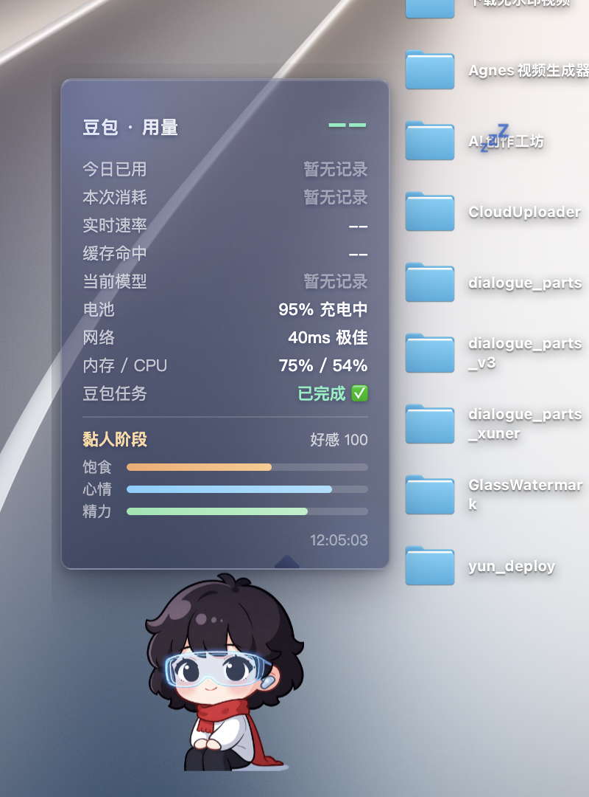
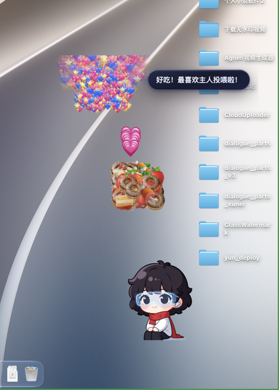
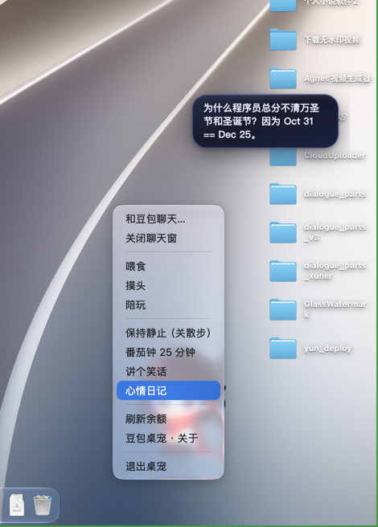
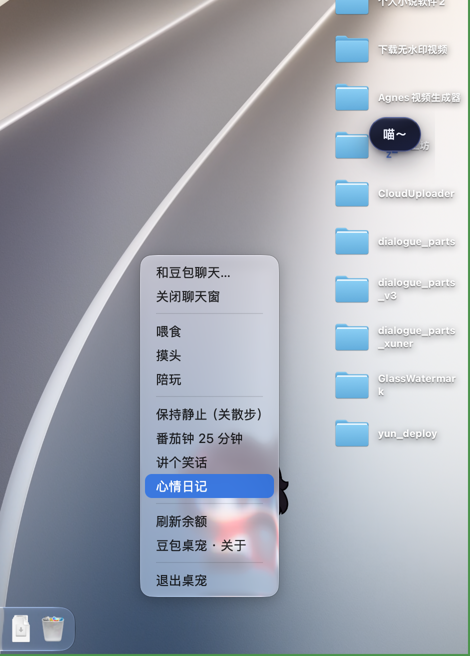

# 🐾 豆包桌宠（PetAgent）

一个真正"活"在桌面上的 AI 桌宠 —— 透明悬浮窗 + Live2D 模型 + 豆包 AI 聊天 + 系统监测 + 用量统计，支持 **macOS / Windows / Android** 三端。



## ✨ 功能特性

### 🐾 基础行为（让它"活"在桌面上）
- **透明置顶悬浮窗**：无边框透明窗口，始终显示在最前，支持鼠标穿透
- **可拖拽 + 位置记忆**：拖到任意角落，重启后记得自己待的地方
- **散步**：宠物在窗口内左右散步、碰边小跳转身（窗口/桌子不移动）
- **发呆 / 睡觉**：长时间空闲自动发呆、深夜睡觉（💤），点击唤醒

### ❤️ 互动与陪伴（有性格的伙伴）
- **多模态反馈**：点击弹跳、喂食咀嚼动画 + 音效、摸头爱心、陪玩弹跳
- **好感度 / 状态系统**：饱食、心情、精力三状态 + 好感度阶段（生疏→熟悉→黏人），喂食摸头提升好感
- **情境感知台词**：识别你正在用的应用说应景的话、分时段问候、实时天气播报、专注模式（你忙时安静待着）
- **冷笑话 + 心情日记**：右键菜单"讲个笑话"，每天自动记录心情分

### 🛠️ 实用工具属性（不止是可爱）
- **AI 聊天**：接入 OpenAI 兼容 API（豆包 / DeepSeek），气泡式聊天窗（带关闭按钮），回答后宠物播报本次用量
- **本地代理 + 用量统计**：本地 127.0.0.1:8899 代理记账，今日已用 / 本次消耗 / 实时速率 / 缓存命中
- **系统监测**：电池电量 / 充电状态、网络延迟、内存 / CPU 占用、温度
- **智能提醒**：低电量（≤20%）、内存过高（≥85%）、CPU 过高（≥85%）、温度异常自动提醒主人
- **豆包任务实时监测**：宠物实时显示豆包聊天任务状态（处理中 / 已完成 ✔）
- **番茄钟 / 倒计时提醒**：右键菜单启动，到点宠物提醒
- **拖文件喂宠物**：把文件拖给它 → "吃掉"（移到系统废纸篓，可恢复）

### 🎨 个性化与扩展
- **形象自定义**：替换 `assets/pet.png` 或 Live2D 模型即可换形象
- **磨砂玻璃 UI**：简洁小圆角 + 磨砂玻璃质感面板

## 📸 截图

| 用量面板 | 喂食特效 | 右键菜单 | 心情日记 |
|---|---|---|---|
|  |  |  |  |

## 🚀 快速开始

### macOS
```bash
git clone https://github.com/CianLaw/pet-agent.git
cd pet-agent
npm install
npm start
```
或直接使用打包好的 App：从 [Releases](https://github.com/CianLaw/pet-agent/releases) 下载 `doubao-pet-macOS-arm64.zip`（Apple Silicon），解压后拖入应用程序运行。

### Windows
从 [Releases](https://github.com/CianLaw/pet-agent/releases) 下载 `doubao-pet-Windows-x64.zip`，解压后运行 `豆包桌宠.exe` 即可。

### Android
从 [Releases](https://github.com/CianLaw/pet-agent/releases) 安装 `doubao-pet-v5.4-android.apk` → 打开 App → 填入 API Key → 授予悬浮窗权限 → 点"启动桌宠"。

## ⚙️ 配置

编辑 `config.json`（macOS: `~/Library/Application Support/PetAgent/config.json`，Windows: `%APPDATA%/PetAgent/config.json`）：

```json
{
  "apiBase": "https://api.deepseek.com",
  "apiKey": "sk-你的API密钥",
  "model": "deepseek-chat"
}
```

> 支持任意 OpenAI 兼容 API（豆包 / DeepSeek / OpenAI 等），改 `apiBase` 即可。
> **修改配置后需重启桌宠生效。**

## 🔌 技术栈

- **Electron**：跨平台桌面悬浮窗
- **Live2D**（live2d-widget）：真 2D 动画模型（shizuku，本地化自包含）
- **本地 HTTP 代理**：拦截并记账 AI API 请求（token / 余额）
- **原生系统 API**：电池（pmset）、网络延迟、内存 / CPU、前台应用
- **Android**：Gradle + WebView 悬浮窗 + 原生桥（Java）

## 📁 项目结构

```
pet-agent/
├── main.js               # Electron 主进程（窗口、代理、监测、行为、IPC）
├── preload.js            # 渲染层安全桥
├── config.json           # API Key / 模型计价 / 监测间隔
├── lib/
│   ├── proxy.js          # 本地代理记账
│   ├── stats-store.js    # 按天统计持久化
│   ├── system-monitor.js # 电池 + 网络 + 内存/CPU + 前台应用监测
│   ├── pet-store.js      # 好感度 / 状态持久化
│   └── pet-behavior.js   # 散步 / 发呆 / 睡觉行为
├── renderer/             # Live2D 容器 + 状态气泡 + 聊天窗（磨砂玻璃 UI）
├── assets/live2d/        # shizuku Live2D 模型（本地化）
├── docs/screenshots/     # 截图
└── pet-agent-android/    # Android 工程（WebView 悬浮窗 + 原生桥）
```

## ⚠️ 已知限制

- macOS 首次启动可能弹出"屏幕录制"权限窗（用于识别前台应用以提供场景台词）：点"允许"解锁场景台词，点"拒绝"则自动降级（时间问候仍可用），不影响其他功能。
- Windows 版在 macOS 上交叉打包，exe 未嵌自定义图标（默认 Electron 图标）。
- Android 版为 WebView 悬浮窗实现，Live2D 表现以真机为准。
- AI API 用量按 token 估算，实际扣费以官方账单为准。

## 📄 License

MIT License —— 自由使用、修改、分发，请保留作者署名。

## 🙏 致谢

- [live2d-widget](https://github.com/stevenjoezhang/live2d-widget)：Live2D 渲染引擎
- shizuku Live2D 模型（本地化自包含）
